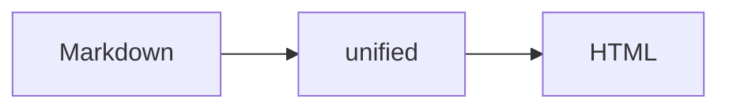

이 글은 `draft: true`라서 개발 서버(`bun run dev`)에서만 보이고 배포에는 포함되지 않습니다. 새 글을 쓸 때 문법을 참고하세요.

## 코드 블록

언어 이름 뒤에 `title="..."`을 붙이면 파일명이, `showLineNumbers`를 붙이면 줄 번호가, `{2,4-5}`를 붙이면 줄 강조가 들어갑니다.

```ts title="src/lib/hello.ts" showLineNumbers {2}
export function hello(name: string): string {
  const greeting = `안녕하세요, ${name}님`;

  return greeting;
}
```

주석 표기로 diff와 강조도 할 수 있습니다.

```js
const before = 1; // [!code --]
const after = 2; // [!code ++]
console.log(after); // [!code highlight]
```

## 콜아웃

> [!NOTE]
> 참고할 내용입니다.

> [!TIP]
> 알아 두면 좋은 내용입니다.

> [!WARNING]
> 주의할 내용입니다.

## 수식

인라인 수식은 $E = mc^2$처럼 쓰고, 블록 수식은 이렇게 씁니다.

$$
\int_0^\infty e^{-x^2}\,dx = \frac{\sqrt{\pi}}{2}
$$

## 다이어그램



## 표, 체크리스트, 각주

| 기능            | 처리 시점 |
| --------------- | --------- |
| 코드 하이라이팅 | 빌드      |
| Mermaid         | 브라우저  |

- [x] 글 쓰기
- [ ] 배포하기

각주는 이렇게 답니다.[^1]

[^1]: 각주 내용은 글 맨 아래에 모입니다.

## 이미지

이미지는 `static/<slug>/` 폴더에 넣고 ``처럼 씁니다.
